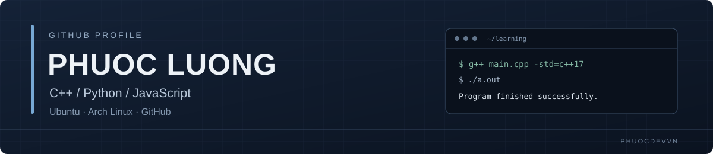
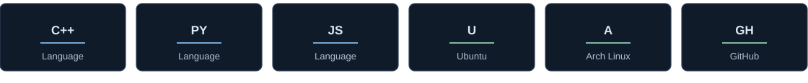
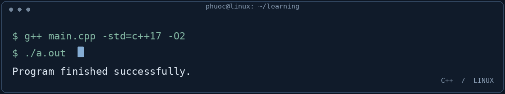

  
   
  
<strong>Student · Programmer</strong>

  
C++ &nbsp;·&nbsp; Python &nbsp;·&nbsp; JavaScript &nbsp;|&nbsp; Ubuntu &nbsp;·&nbsp; Arch Linux

  <a href="https://github.com/phuocdevvn">github.com/phuocdevvn</a>

---

## About

I'm Phước, a student learning programming by building, testing, and improving small things. My current focus is **C++**, **Python**, and **JavaScript**. I use **Ubuntu** and **Arch Linux** as my Linux environments.

## What I'm learning

| Language | Current focus |
|:--|:--|
| **C++** | Programming fundamentals, problem solving, algorithms, and data structures |
| **Python** | Core language features, scripting, and small utilities |
| **JavaScript** | Language fundamentals and practical programming |

## My environment

  

## At the terminal

  

## GitHub

I use this profile to keep track of what I'm learning and the code I work on. More projects and notes will appear here as they take shape.

  

